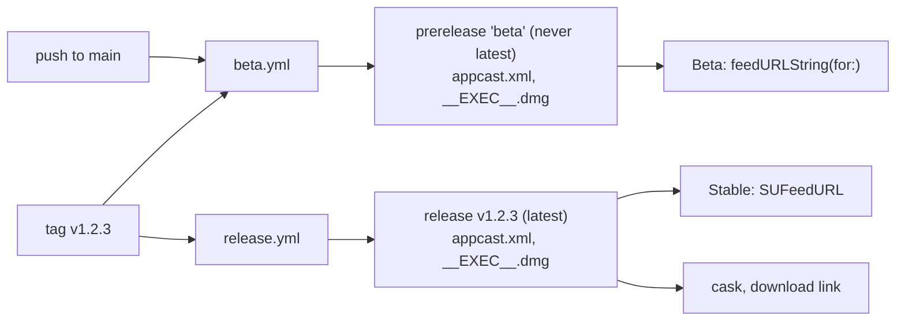

# Two update channels: Stable and Beta

One Sparkle setup gives two feeds. Stable is the latest GitHub release. Beta is one rolling GitHub prerelease, rebuilt on each push to `main`. Both builds use the same certificate and the same EdDSA key, so a user can change channel and keep permissions and Keychain access.

## Parts

| Part | Where | What it does |
|---|---|---|
| Stable feed | `SUFeedURL` in `Info.plist`: `.../releases/latest/download/appcast.xml` | A prerelease is never "latest", so betas never reach it, the cask or the download link |
| Beta feed | `Updater.swift`, `SPUUpdaterDelegate.feedURLString(for:)` | Returns `.../releases/download/beta/appcast.xml` on Beta, `nil` (use `SUFeedURL`) on Stable |
| Channel setting | `updateChannel` in the user defaults, a segmented Stable/Beta picker | Changing it changes the next check; no restart |
| Beta build | `templates/release/.github/workflows/beta.yml` | Runs on each push to `main` and each `v*` tag; `concurrency: beta` with `cancel-in-progress` keeps only the newest build |
| Beta publish | `git tag -f beta`, then `gh release upload --clobber` and `edit --prerelease --latest=false` | Replaces the files of one prerelease; old betas are not kept |

## Versions

Sparkle compares `CFBundleVersion` and never installs an older version.

| Build | `CFBundleVersion` | Short version |
|---|---|---|
| Release `v1.2.3` | `1.2.3` | `1.2.3` |
| 8th commit after `v1.2.3` | `1.2.3.8` | `1.2.3.8 beta (<sha>)` |
| The tagged commit, on the beta feed | `1.2.3` | `1.2.3 beta (<sha>)` |

`1.2.3.8` is above `1.2.3` and below `1.2.4`. Because `beta.yml` also runs on the tag, a beta user gets each release. On a tag, both workflows run at the same time; they do not share files.

## Changing channel

- Stable to Beta: the next check finds the newest beta.
- Beta to Stable: the app keeps the beta until a release is newer. There is no downgrade. Say this next to the picker.

## Notes

Stable shows the version's hand-written `CHANGELOG.md` section. Beta shows the commits since the last `v` tag from `release-notes.sh`, grouped by Conventional Commits type, for testers. A commit check (`check-commits.sh`) keeps the subjects in that form.

## Traps

| Symptom | Cause | Fix |
|---|---|---|
| Beta version or notes come from `beta`, notes are empty | `git describe --tags` finds the rolling `beta` tag | `--match 'v*'` |
| `beta.yml` fails on the first push | No `v` tag yet | Push one release tag first |
| A beta user is asked for permissions again | The beta was signed with another identity | Both workflows import the same `.p12` and check `Authority=` |
| A beta shows as the latest release, or the cask moves to it | `--latest` not set to false | `gh release create/edit --prerelease --latest=false` |
| Old beta right after a push | GitHub's CDN kept the old `appcast.xml` 30 to 90 s | Wait two minutes before you check |
| A background app (`LSUIElement`) shows Sparkle's window at once on a scheduled check | Sparkle's gentle reminders are not set up | Known gap; Sparkle logs a warning |

## Test a channel switch

On a second Mac (or a second user account), install the latest release from the DMG. Set Beta, then Check for Updates: Sparkle offers the newest beta and installs it without new permission prompts. Set Stable again and check: no update until the next release. Do this once after you set up channels; the workflows cannot test it.
